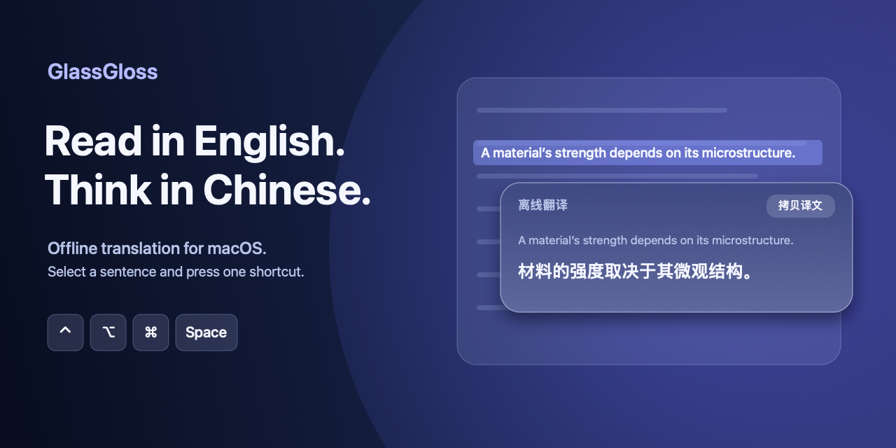

  

  <b>English</b> · <a href="README.zh-CN.md">简体中文</a> · <a href="https://github.com/haotian049-cpu/glassgloss/releases/latest">Release</a>

# GlassGloss

**Select English. Press ⌃⌥⌘Space. Keep reading in Chinese.**

GlassGloss brings English → Simplified Chinese translation to the page you're reading. A native macOS Liquid Glass panel opens beside the text. A sentence takes up a few lines. A long passage scrolls in place. **Esc** closes it.

- **One shortcut** reads the selection in a compatible browser, PDF reader, or editor.
- **On-device** translation uses Apple's installed models. No account, API key, upload, or translation history.
- **Compact by design** with a panel that sizes itself to the text, selectable source and translation, and one-click copy.

## Install

**[Download the complete package](https://github.com/haotian049-cpu/glassgloss/releases/latest)** · Apple silicon · macOS 26.4+

1. Download the ZIP, extract it, and open `Install.command`. You can also run `bash install.sh` from the extracted folder. The package is precompiled and installs into your user Library without sudo.
2. In **Dictionary → Settings**, enable the new dictionaries. Quit and reopen Dictionary first if it was open during install.
3. In **System Settings → General → Language & Region → Translation Languages**, download English and Simplified Chinese. Select an English sentence, then press **Control + Option + Command + Space**. If macOS asks for permission, authorize only the readers you use when **Choose Apps** is available.

The release is locally signed and **not Apple-notarized**. If your Mac blocks the prebuilt installer or service, use the source build below. [Apple's translation guide](https://support.apple.com/en-us/guide/mac-help/mchldd8b3c15/mac) · [Apple's permission guide](https://support.apple.com/en-us/149699)

## What's inside

| For | Included |
| --- | --- |
| Words and terms | Four native dictionaries for Dictionary.app and macOS Look Up: ECDICT, Google AI, MDN and Python. |
| Sentences and passages | GlassGloss's on-device English → Simplified Chinese floating panel. |

The installer preserves existing dictionaries with the same name or bundle ID. The dictionaries retain their [original licenses and attribution](docs/THIRD-PARTY.md). A scanned page needs a selectable text layer. When a reader does not expose its selection directly, GlassGloss uses its Copy command and updates the clipboard.

## Optional commands

- `bash install.sh translate` installs just the translator.
- `bash install.sh dictionaries` installs just the four data bundles from the complete ZIP.
- `bash install.sh uninstall` removes the translator and per-user startup entry. Dictionary files can be managed separately in `~/Library/Dictionaries/`.

For a local source build, install the current Apple Command Line Tools with `xcode-select --install`, then run:

~~~sh
git clone https://github.com/haotian049-cpu/glassgloss.git
cd glassgloss
bash install.sh source
~~~

Use `bash install.sh build` to build without installing. Maintainers can assemble the complete archive with `bash scripts/package.sh DICTIONARY_DIRECTORY OUTPUT_DIRECTORY`.

## Feedback

If GlassGloss helps you stay on the page, a star helps other Mac readers find it. For a selection or rendering issue, include the macOS version, reader name, and a short public example.

[MIT](LICENSE)
