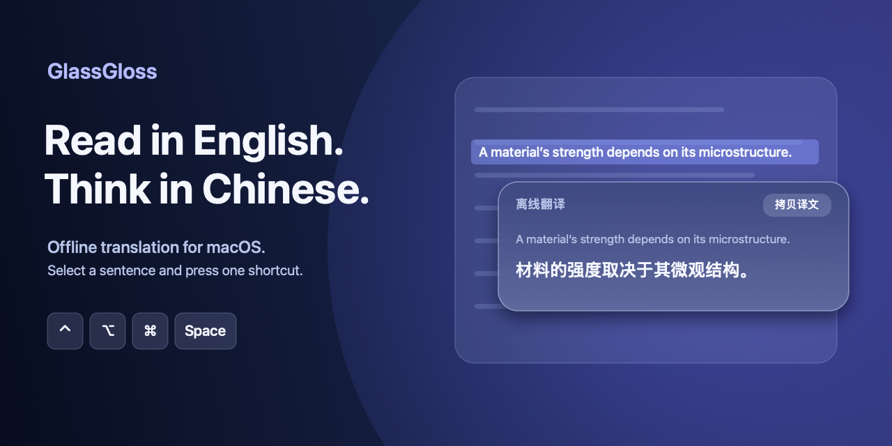

  

  <a href="README.md">English</a> · <b>简体中文</b> · <a href="https://github.com/haotian049-cpu/glassgloss/releases/latest">发布版本</a>

# GlassGloss

**选中英文，按 ⌃⌥⌘空格，中文就在原处。**

读论文、PDF 或技术文档时，GlassGloss 把译文放在原文旁边的 macOS 原生液态玻璃悬浮窗里。短句只占几行，长文在窗内滚动，按 **Esc** 回到阅读。

- **选中即译**。兼容的阅读器、浏览器和编辑器里，选中文字即可发起翻译。
- **本机离线**。使用 Apple 已下载的英文和简体中文模型，无需账号或 API Key，不上传选区，也不保存翻译历史。
- **随内容变化的浮窗**。原文、译文都能选中，也可以一键拷贝整段译文。

## 安装

需要 **Apple 芯片 Mac**、**macOS 26.4 或更新版本**和新版 Apple 命令行工具。如果还没装命令行工具，先运行 `xcode-select --install`。

~~~sh
git clone https://github.com/haotian049-cpu/glassgloss.git
cd glassgloss
bash install.sh
~~~

1. 在 **系统设置 → 通用 → 语言与地区 → 翻译语言**下载英语和简体中文。语言包就绪后，翻译在本机运行。 [Apple 的翻译语言说明](https://support.apple.com/zh-cn/guide/mac-help/mchldd8b3c15/mac)
2. 选中英文，按 **Control + Option + Command + 空格**。首次可能需要允许 GlassGloss 读取选区或代为复制。可以从弹窗打开权限设置。如果系统提供 **选择 App（Choose Apps）**，只授权实际使用的阅读器。服务位于 `~/Library/Services/GlassGloss.service`。 [Apple 的权限说明](https://support.apple.com/en-us/149699)

扫描版 PDF 需要先有可选中文字。阅读器不直接提供选区时，工具会代为执行复制，并更新系统剪贴板。

## 卸载与构建

运行 `bash install.sh uninstall` 停止服务并移除登录启动项。已授予的系统权限可以在原页面移除。

运行 `bash install.sh build` 可以仅在本地构建。

如果它帮你读文档少切几次窗口，欢迎点个 Star。遇到兼容性问题，可以在 Issues 里附上 macOS 版本、阅读器名称和一段可公开的复现文本。

[MIT](LICENSE)
